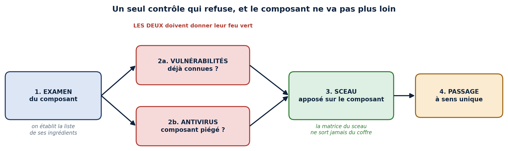
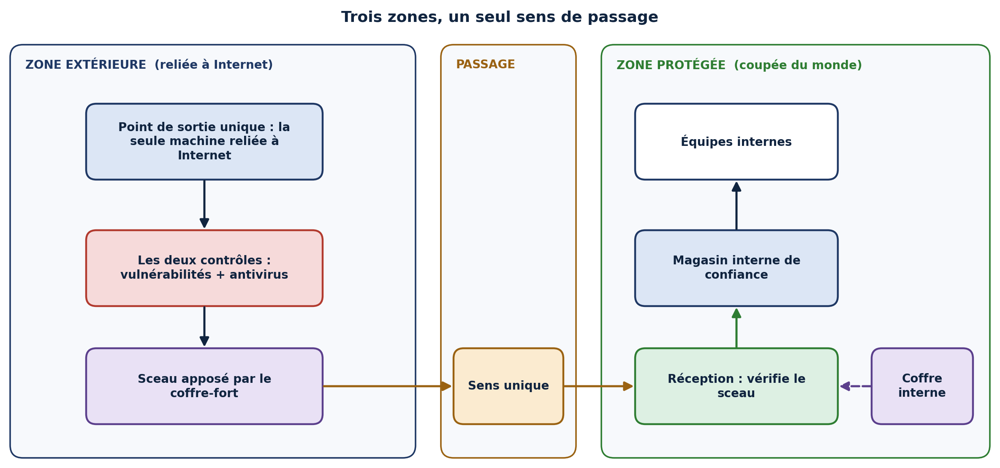
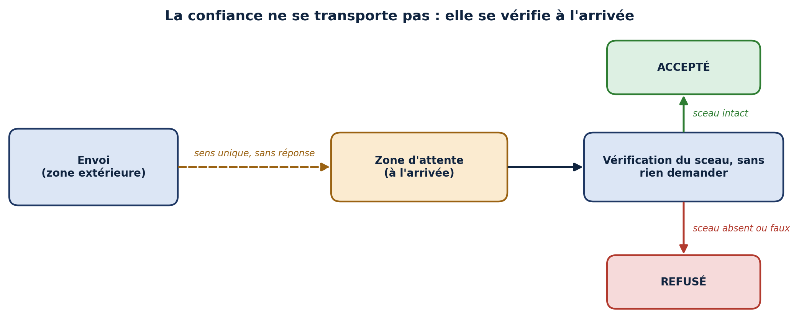

# schema-kit

**Des schémas d'architecture propres, dessinés par un LLM.**

Une petite bibliothèque Python, plus les consignes qui apprennent à un modèle de langage à s'en servir. Tu décris un schéma en français courant, le LLM écrit le script, et l'image sort.

| | |
|---|---|
|  |  |
|  |  |

## Installation

```bash
git clone https://github.com/mpicherie/schema-kit.git
cd schema-kit
pip install -e .
```

Vérification : `python exemples/01_chaine.py` doit écrire `exemples/images/01_chaine.png`.

## Trois façons de s'en servir

### 1. Avec un agent (recommandé)

Ouvre le dossier dans ton outil d'agent (opencode, Cline, Continue, Aider, Roo Code…) branché sur ton modèle, par exemple DeepSeek, et dis-lui :

> **Lis AGENTS.md, puis fais-moi un schéma de** *< ce que tu veux montrer >*.

L'agent lit les consignes, écrit le script dans `schemas/`, l'exécute, corrige tant qu'il reste des alertes de mise en page, puis te donne le chemin du PNG.

### 2. En une commande

`generer.py` envoie ta demande au modèle, exécute le script reçu et lui renvoie ses erreurs jusqu'à obtenir une image propre (3 essais par défaut).

**Avec l'API DeepSeek :**

```powershell
$env:DEEPSEEK_API_KEY = "sk-..."          # PowerShell ; sous bash : export DEEPSEEK_API_KEY=sk-...
python generer.py --modeles --url https://api.deepseek.com/v1      # liste les identifiants exacts
python generer.py "le parcours d'une commande : panier, paiement, livraison" -o commande.png `
       --url https://api.deepseek.com/v1 --modele <identifiant>
```

**Avec un modèle local :**

| Serveur | Option |
|---|---|
| Ollama | `--url http://localhost:11434/v1` (défaut) |
| LM Studio | `--url http://localhost:1234/v1` |

Le modèle se choisit avec `--modele`, ou une fois pour toutes avec la variable `SCHEMA_MODELE` (même chose pour l'adresse avec `SCHEMA_URL`).

Chaque génération écrit trois fichiers côte à côte : `commande.png` (aperçu), `commande.pdf` (vectoriel, à insérer dans un document) et `commande.py` (le script, pour retoucher à la main). `-o commande.svg` ajoute le SVG.

## Dans un document PDF

Le PDF produit est **vectoriel** : net à n'importe quel zoom, texte sélectionnable, une vingtaine de Ko. Utilise-le pour LaTeX (`\includegraphics{commande.pdf}`) ou un PDF généré par code ; garde le PNG pour Word, PowerPoint ou une page web. `AGENTS.md` donne à l'agent la marche à suivre, exemple compris.

### 3. Dans n'importe quel chat

Colle le contenu de `PROMPT_SYSTEME.md` comme message système, ou en premier message, puis décris ton schéma. Le modèle répond par un script : enregistre-le dans le dossier du dépôt et lance-le avec `python`.

## Écrire un schéma à la main

```python
from schema_kit import Schema

s = Schema(12, 3.6, titre="Le parcours d'une commande, du panier à la livraison")
e = s.chaine(["Panier\nvalidé", "Paiement\naccepté", "Livraison\nau client"],
             couleurs=["blanc", "bleu", "vert"])
s.annoter(e[1], "aucune donnée bancaire stockée")
s.enregistrer("commande.png")
```

L'API complète, avec le repère, les couleurs et les règles de style, est dans [`PROMPT_SYSTEME.md`](PROMPT_SYSTEME.md).

## Pourquoi un LLM s'en sort bien

Un modèle de langage calcule mal les coordonnées. La bibliothèque fait donc ce travail à sa place :

- **Les boîtes ont un nom**, et `fleche("a", "b")` choisit seule les bons côtés où s'accrocher.
- **Le texte se replie** à la largeur de la boîte, et la police rétrécit si la boîte est trop petite. Le texte d'une flèche se replie à la longueur de la flèche.
- **`chaine()` et `pile()`** placent, centrent et relient des boîtes sans aucune coordonnée.
- **Les erreurs de mise en page sont signalées** à l'enregistrement : boîtes qui se chevauchent, qui sortent du cadre, ou qui empiètent sur le titre. Le message dit quoi corriger, et une erreur de nom liste les boîtes qui existent. Le modèle se corrige donc seul au tour suivant.
- **Le titre se place seul**, centré juste au-dessus du dessin réel, et les blancs sont rognés : pas de titre décentré ni de grande marge vide si le modèle n'occupe pas toute la feuille.
- **Les couleurs ont un sens fixé** (vert = accepté, rouge = contrôle ou refus, ambre = passage…), et les règles de style imposent un titre qui énonce le message du schéma.

## Organisation du dépôt

| Fichier | Rôle |
|---|---|
| `schema_kit.py` | la bibliothèque |
| `PROMPT_SYSTEME.md` | l'API, les règles de style et des exemples, pour le LLM |
| `AGENTS.md` | la méthode de travail d'un agent |
| `generer.py` | le lanceur en une commande, avec correction automatique |
| `exemples/` | quatre schémas types, à copier |
| `schemas/` | **tes** schémas. Ce dossier est ignoré par git : rien n'y est jamais publié. |

## Sécurité

`generer.py` et le mode agent **exécutent le code écrit par le modèle**, sur ta machine et avec tes droits. Le lanceur travaille dans un dossier temporaire, mais ce n'est pas un bac à sable. Lis le script avant de l'exécuter si tu utilises un modèle en qui tu n'as pas confiance.

Ta clé d'API se passe par variable d'environnement. Elle n'est jamais écrite sur le disque ni affichée.
